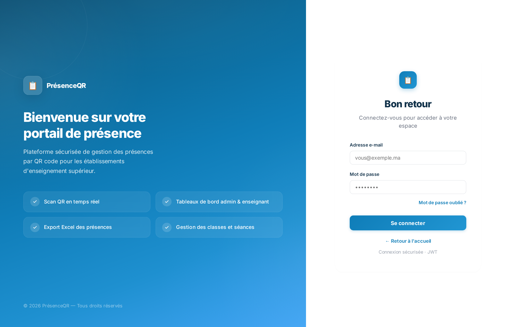
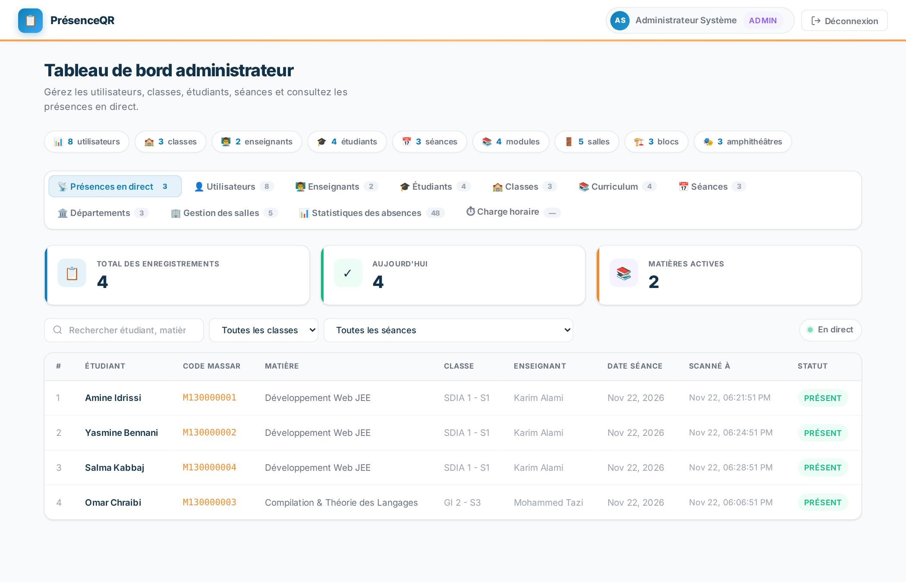
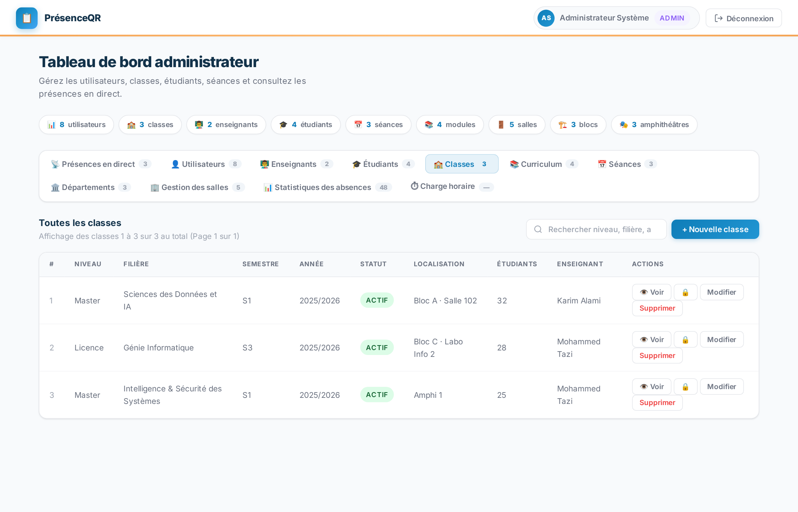
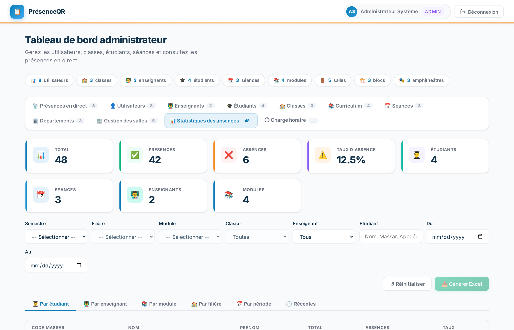
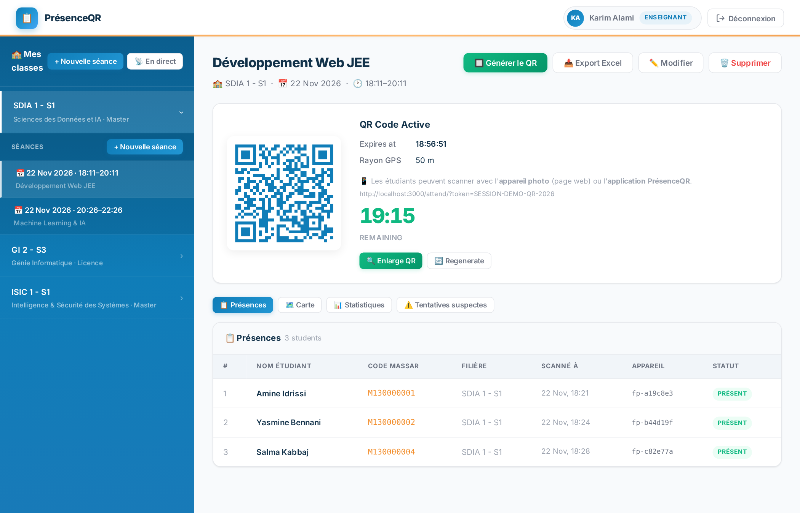
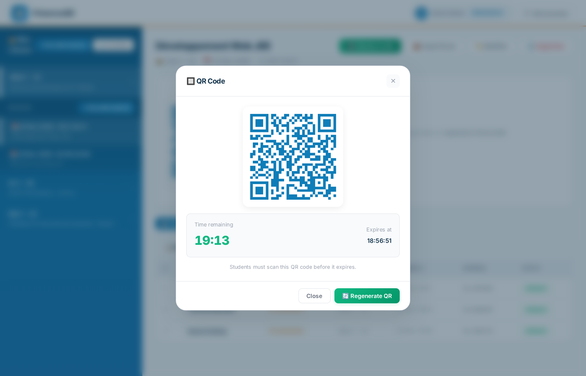
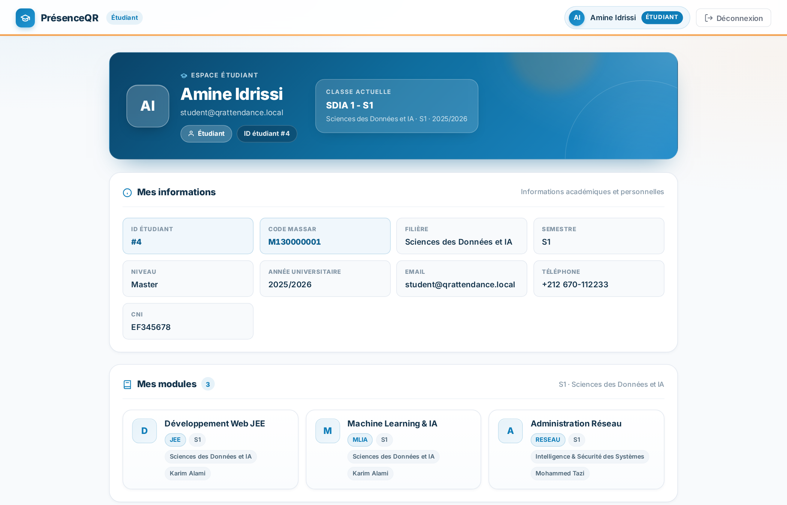
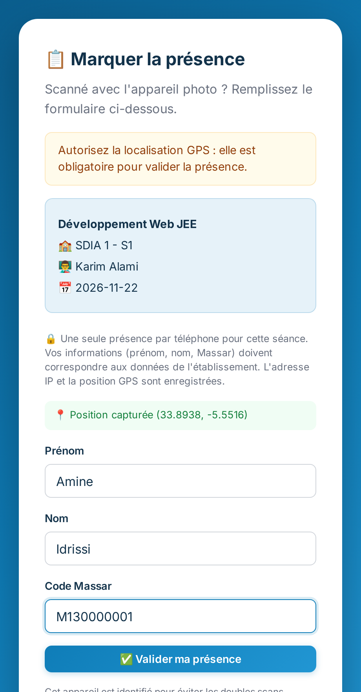

# 📋 PrésenceQR — Système Universitaire de Gestion des Présences par QR Code

<div align="center">

[](https://www.djangoproject.com/)
[](https://flutter.dev/)
[](https://nodejs.org/)
[](https://channels.readthedocs.io/)
[](https://www.postgresql.org/)
[](https://github.com/abdertalibi-gif/Qr_code_pfe-)

**Plateforme complète de gestion et de validation des présences universitaires par QR Code dynamique, géolocalisation GPS, empreinte appareil anti-fraude, suivi temps réel par WebSocket et export Excel.**

[Captures d'Écran Réelles](#-captures-décran-de-lapplication) • [Architecture](#-architecture-du-projet) • [Fonctionnalités](#-fonctionnalités-principales) • [Installation](#-installation-et-démarrage) • [Application Mobile](#-application-mobile-flutter) • [API REST](#-documentation-de-lapi-rest-v1)

</div>

---

## 📸 Captures d'Écran de l'Application

> Toutes les captures ci-dessous proviennent directement de l'exécution réelle de l'application **PrésenceQR**.

### 🌐 1. Page d'Accueil Institutionnelle (`/`)
Portail vitrine présentant les indicateurs clés de l'établissement en temps réel, les fonctionnalités principales et l'accès rapide à la connexion.

<div align="center">
  
</div>

---

### 🔐 2. Portail d'Authentification JWT (`/login/`)
Interface de connexion sécurisée par jetons JWT (`SimpleJWT`) avec réinitialisation de mot de passe par vérification d'identité (Code Massar pour étudiants, CNE/CIN pour enseignants).

<div align="center">
  
</div>

---

### 📡 3. Tableau de Bord Administrateur — Présences en Direct (`/admin-ui/`)
Supervision globale en temps réel via WebSocket (`En direct`) : suivi instantané des scans étudiants, filtrage par classe ou séance, et compteurs globaux de l'université.

<div align="center">
  
</div>

---

### 🏫 4. Administration Académique — Gestion des Classes (`/admin-ui/`)
Gestion structurée des cohortes par **Niveau** (Licence / Master), **Filière**, **Semestre**, **Année universitaire**, localisation (Blocs/Salles/Amphis) et enseignants responsables.

<div align="center">
  
</div>

---

### 📈 5. Statistiques des Absences & Rapports (`/admin-ui/`)
Tableau analytique détaillé avec taux d'absentéisme global, filtrage multi-critères (semestre, filière, module, classe, enseignant, étudiant, période) et export Excel automatisé.

<div align="center">
  
</div>

---

### 👨‍🏫 6. Espace Enseignant & Liste de Présence en Direct (`/teacher/`)
Interface dédiée aux enseignants : sélection des classes et séances, génération de QR code géolocalisé, suivi en direct des étudiants scannés (`Code Massar`, empreinte appareil, statut), carte Leaflet des scans et journal des tentatives suspectes.

<div align="center">
  
</div>

---

### 🔲 7. Modale QR Code Dynamique Plein Écran (`/teacher/`)
Affichage haute visibilité pour vidéoprojecteur en salle ou amphithéâtre, incluant le compte à rebours d'expiration automatique et la régénération instantanée du jeton.

<div align="center">
  
</div>

---

### 🎓 8. Espace Étudiant — Profil, Modules & Emploi du Temps (`/student/`)
Portail personnel de l'étudiant affichant ses identifiants officiels (**Code Massar**, **ID Étudiant**, **CNI**), sa classe, ses modules inscrits, son emploi du temps synchronisé par WebSocket et son historique de présences.

<div align="center">
  
</div>

---

### 📱 9. Émargement Mobile & Validation Anti-Fraude (`/attend/?token=...`)
Écran optimisé smartphone permettant à l'étudiant de valider sa présence après scan du QR code : vérification obligatoire de la **position GPS**, contrôle de **proximité (rayon configuré)** et blocage des doubles scans par **empreinte unique de l'appareil**.

<div align="center">
  
</div>

---

## 🎯 Fonctionnalités Principales

### 🛡️ Sécurité & Dispositif Anti-Fraude
* **QR Codes Dynamiques à Durée Limitée** : Génération de jetons uniques avec expiration configurable (par défaut 20 min) et invalidation immédiate après clôture de la séance.
* **Géorepérage GPS (Geofencing)** : Capture des coordonnées de la salle par l'enseignant et calcul de distance côté serveur pour rejeter tout scan hors du rayon autorisé (`20m`, `50m`, `100m`, `200m`).
* **Empreinte Appareil (Device Fingerprinting)** : Identification unique du téléphone/navigateur (`device_id` + `device_fingerprint`) empêchant un étudiant de valider la présence d'un camarade depuis le même appareil.
* **Journal des Tentatives Suspectes** : Enregistrement et alerte en temps réel des tentatives de doublon, scans hors zone ou adresses IP suspectes.

### ⚡ Synchronisation Temps Réel & Rôles
* **WebSockets Multi-Canaux** :
  * `/ws/attendance/<session_id>/` : flux live sur la fiche de séance de l'enseignant.
  * `/ws/attendance/live/` : flux global sur le tableau de bord administrateur.
  * Mises à jour automatiques de l'emploi du temps étudiant (`student_signals.py`).
* **Gestion des Rôles (RBAC)** :
  * **Administrateur (`admin`)** : gestion complète (utilisateurs, départements, filières, classes, salles, blocs, amphis, statistiques, charge horaire).
  * **Chef de Département (`department_head`) & Responsable de Filière (`program_manager`)** : pilotage ciblé de leur périmètre académique.
  * **Enseignant (`teacher`)** : gestion de ses séances, génération de QR, suivi en direct et export Excel.
  * **Étudiant (`student`)** : emploi du temps live, historique et validation de présence.

### 📊 Exports & Rapports Excel
* **Assistant d'Export Avancé (`openpyxl`)** : export par séance, par module, par étudiant ou résumé global des présences/absences et rapports mensuels de charge horaire.
* **Import par Lots (Batch Import)** : scripts et endpoints dédiés à l'import Excel des enseignants et étudiants.

---

## 🏗️ Architecture du Projet

Le dépôt est structuré en trois couches complémentaires :

```text
.
├── backend/                         # Backend principal Django 6 + DRF + Channels (Daphne ASGI)
│   ├── config/                      # settings.py, urls.py, asgi.py, wsgi.py
│   ├── users/                       # Authentification JWT, Rôles, Étudiants, Enseignants, Classes, Salles
│   ├── curriculum/                  # Niveaux, Semestres, Départements, Filières, Modules
│   ├── courses/                     # Séances (Cours/TD/TP), planification & détection de conflits
│   ├── attendance/                  # Validation QR, GPS, Anti-fraude, Consumers WebSocket, Exports Excel
│   └── templates/                   # Interfaces web HTML/CSS/JS (landing, login, admin, teacher, student, attend)
│
├── mobile/                          # Application mobile cross-platform Flutter (Dart 3.11+)
│   ├── lib/
│   │   ├── providers/               # Gestion d'état (AuthProvider, AttendanceProvider, TeacherProvider, StudentProvider)
│   │   ├── services/                # Client Dio, Deep Links (presenceqr://), WebSocket emploi du temps
│   │   └── screens/                 # Écrans Login, Scanner QR (mobile_scanner), Espaces Étudiant & Enseignant
│   └── pubspec.yaml                 # geolocator, mobile_scanner, flutter_map, dio, web_socket_channel
│
├── server.ts                        # Serveur de prévisualisation Node.js / Express + WebSocket (Port 3000)
├── public/                          # Assets statiques & vues web servies pour l'aperçu instantané
├── docs/screenshots/                # Captures d'écran HD de l'application
├── docker-compose.yml               # Orchestration Docker (PostgreSQL + Redis + Daphne ASGI)
├── requirements.txt                 # Dépendances Python du backend Django
└── README.md                        # Documentation officielle du projet
```

---

## 👤 Comptes de Démonstration (Mode Aperçu)

| Rôle | Adresse E-mail | Mot de passe | Espace |
|---|---|---|---|
| **Administrateur** | `admin@qrattendance.local` | `admin` | `/admin-ui/` |
| **Enseignant** | `teacher@qrattendance.local` | `admin` | `/teacher/` |
| **Étudiant** | `student@qrattendance.local` | `admin` | `/student/` |
| **Chef de Département** | `depthead@qrattendance.local` | `admin` | `/admin-ui/` |

> **Lien direct de test d'émargement QR** : `/attend/?token=SESSION-DEMO-QR-2026`

---

## 🚀 Installation et Démarrage

### Option 1 : Démarrage Rapide (Aperçu Web Node.js — Port 3000)
Idéal pour explorer immédiatement toutes les interfaces web, la génération de QR codes et les WebSockets sans configuration de base de données :

```bash
# Installer les dépendances Node.js
npm install

# Démarrer le serveur Express + WebSocket sur http://localhost:3000
npm run dev
```

### Option 2 : Backend Django Complet (Production / Local)

```bash
# 1. Configurer les variables d'environnement
cp .env.example .env

# 2. Créer l'environnement Python et installer les dépendances
python -m venv .venv
source .venv/bin/activate   # Sous Windows PowerShell : .\.venv\Scripts\Activate.ps1
pip install -r requirements.txt

# 3. Appliquer les migrations et démarrer le serveur ASGI (Daphne)
cd backend
python manage.py migrate
python manage.py createsuperuser
python manage.py runserver 0.0.0.0:8000
```

### Option 3 : Conteneurisation Docker (PostgreSQL + Redis + Daphne)

```bash
docker compose up --build
```

---

## 📱 Application Mobile (Flutter)

L'application Flutter située dans `/mobile/` permet aux enseignants de créer des séances / afficher le QR code et aux étudiants de scanner directement avec la caméra native (`mobile_scanner`) et le GPS (`geolocator`) :

```bash
cd mobile
flutter pub get
flutter analyze
flutter test

# Émulateur Android (vers backend local)
flutter run --dart-define=DEV_HOST=10.0.2.2

# Appareil physique sur le même réseau Wi-Fi
flutter run --dart-define=DEV_HOST=<IP_LOCALE_PC>

# Vers un serveur distant
flutter run --dart-define=API_BASE_URL=https://votre-domaine.com/api/v1
```

* **Schéma de Deep Link** : `presenceqr://attend?token=<QR_TOKEN>`

---

## 🔌 Documentation de l'API REST v1

Toutes les routes API sont préfixées par `/api/v1/` (documentation interactive Swagger disponible sur `/api/docs/swagger/` avec le backend Django).

| Domaine | Méthode & Endpoint | Description |
|---|---|---|
| **Auth** | `POST /api/v1/auth/login/` | Authentification email/mot de passe → retourne `access`, `refresh`, `user` |
| **Auth** | `POST /api/v1/auth/refresh/` | Rafraîchissement du jeton JWT |
| **Auth** | `GET /api/v1/auth/me/` | Profil complet de l'utilisateur (incluant `student_profile` et modules) |
| **Séances** | `GET / POST /api/v1/sessions/` | Liste filtrable et création de séances |
| **QR Code** | `POST /api/v1/sessions/:id/generate-qr/` | Génère un QR code dynamique avec expiration et coordonnées GPS |
| **QR Code** | `GET /api/v1/sessions/:id/current-qr/` | Récupère le QR code actif d'une séance en base64 |
| **Scan QR** | `GET /api/v1/attendance/qr-info/?token=...` | Vérifie la validité du QR et retourne les infos de la séance |
| **Scan QR** | `POST /api/v1/attendance/validate/` | Valide la présence étudiante (contrôles GPS + device fingerprint + diffusion WS) |
| **Suivi** | `GET /api/v1/attendance/session/:id/` | Liste des présences d'une séance |
| **Sécurité** | `GET /api/v1/attendance/session/:id/suspicious/` | Journal des tentatives suspectes d'une séance |
| **Stats** | `GET /api/v1/dashboard/counts/` | Compteurs globaux du tableau de bord administrateur |
| **Stats** | `GET /api/v1/absence-stats/` | Statistiques détaillées des absences par étudiant, module, filière et période |
| **Stats** | `GET /api/v1/teacher-workload/` | Charge horaire par enseignant |

---

## 👨‍💻 Auteur

* **Abderrahim Talibi** — Master 1 SDIA (Sciences des Données & Intelligence Artificielle), Université Moulay Ismaïl, Meknès (Maroc).
* **Dépôt GitHub** : [abdertalibi-gif/Qr_code_pfe-](https://github.com/abdertalibi-gif/Qr_code_pfe-)

---

<div align="center">
  <sub>© 2026 PrésenceQR — Projet PFE. Tous droits réservés.</sub>
</div>
