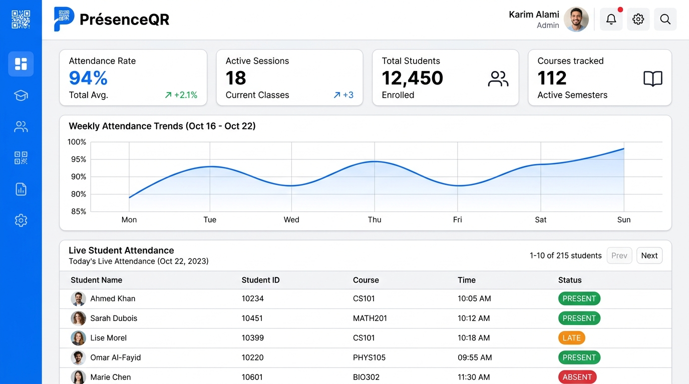
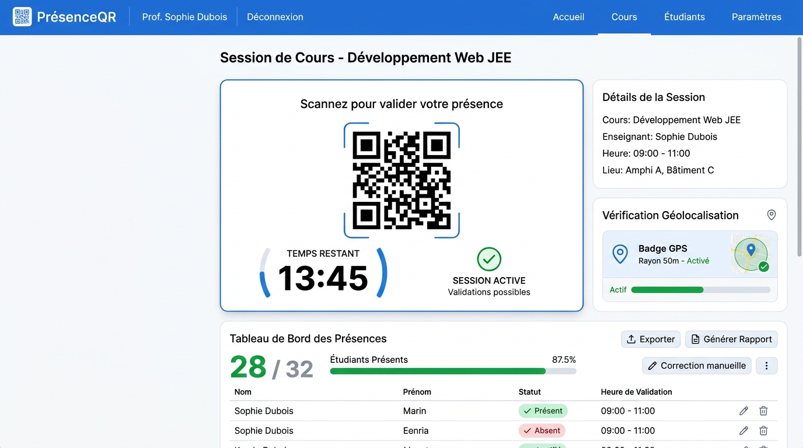

# 📋 PrésenceQR — Gestion des Présences Universitaires par QR Code

<div align="center">

[](https://nodejs.org/)
[](https://www.typescriptlang.org/)
[](https://expressjs.com/)
[](https://developer.mozilla.org/fr/docs/Web/API/WebSocket)
[](https://github.com)
[](LICENSE)

**Plateforme web et mobile intelligente d'émargement étudiant sécurisé par QR Code dynamique, validation GPS, détection anti-fraude et synchronisation WebSocket en temps réel.**

[Fonctionnalités](#-fonctionnalités-principales) • [Captures d'écran](#-captures-décran) • [Comptes Démo](#-comptes-de-démonstration) • [Installation](#-installation-et-démarrage) • [API Documentation](#-documentation-de-lapi-rest-v1)

</div>

---

## 📸 Captures d'Écran

### 🌐 1. Page d'Accueil & Portail Institutionnel
Interface vitrine interactive présentant les statistiques globales, le fonctionnement de l'émargement et les accès sécurisés par rôle.

<div align="center">
  
</div>

---

### 📊 2. Tableau de Bord Administrateur & Statistiques
Console centrale pour la supervision complète de l'établissement : taux de présence global, alertes d'absentéisme, gestion des départements, filières, classes, enseignants et suivi en direct.

<div align="center">
  
</div>

---

### 👨‍🏫 3. Espace Enseignant & Générateur de QR Code Dynamique
Génération de QR codes cryptés à expiration automatique avec compte à rebours, vérification du rayon GPS, liste instantanée des étudiants présents et bascule manuelle en cas de besoin.

<div align="center">
  
</div>

---

### 📱 4. Émargement Étudiant & Validation GPS Anti-Fraude
Validation de présence ultra-rapide par scan ou caméra web avec horodatage, empreinte unique de l'appareil (anti-double scan) et contrôle de proximité géographique.

<div align="center">
  
</div>

---

## 🎯 Fonctionnalités Principales

### 🛡️ Sécurité & Anti-Fraude
* **QR Codes Dynamiques** : Chaque QR code possède un jeton unique à durée de validité configurable (par défaut 15–20 minutes) avec expiration en direct.
* **Vérification Géographique (GPS Geofencing)** : Contrôle automatique que l'étudiant se trouve physiquement dans la salle ou l'amphithéâtre (rayon de 50 m par défaut).
* **Empreinte de l'Appareil (Device Fingerprinting)** : Empêche un étudiant de valider la présence de ses camarades depuis le même smartphone.
* **Journalisation des Tentatives Suspectes** : Détection des adresses IP distantes, anomalies d'horodatage ou de localisation.

### ⚡ Temps Réel & Synchronisation
* **WebSockets Intégrés** : Mise à jour instantanée des tableaux de bord enseignant et administrateur à chaque scan d'étudiant, sans rechargement de page.
* **Occupation des Locaux en Direct** : Suivi de l'occupation en temps réel des salles, blocs et amphithéâtres.

### 📑 Gestion Académique Complète
* **Structure Universitaire** : Départements, Filières, Niveaux (Licence, Master, Ingénieur), Modules et Coefficients.
* **Classes & Étudiants** : Gestion des cohortes, codes Apogée, codes Massar, coordonnées et affectations.
* **Rapports & Exports Excel** : Exportation en un clic des feuilles d'émargement et rapports mensuels de charge horaire.

---

## 👤 Comptes de Démonstration

Le système intègre un jeu de données initial vous permettant de tester immédiatement l'ensemble des rôles :

| Rôle | Adresse E-mail | Mot de passe | Espace Accessible |
|---|---|---|---|
| **Administrateur** | `admin@qrattendance.local` | `admin` | `/admin-ui/` |
| **Enseignant** | `teacher@qrattendance.local` | `admin` | `/teacher/` |
| **Étudiant** | `student@qrattendance.local` | `admin` | `/student/` ou `/attend/` |
| **Chef de Département** | `depthead@qrattendance.local` | `admin` | `/admin-ui/` |

> *Note : Les raccourcis `admin`, `teacher` et `student` sont également acceptés directement dans le champ e-mail pour des tests rapides.*

---

## 🚀 Installation et Démarrage

### Prérequis
* **Node.js** version 20 ou 22 LTS
* **npm** version 9+

### Démarrage Rapide

```bash
# 1. Cloner le projet
git clone https://github.com/abdertalibi-gif/Qr_code_pfe-.git
cd Qr_code_pfe-

# 2. Installer les dépendances
npm install

# 3. Lancer le serveur en mode développement
npm run dev
```

L'application est immédiatement accessible sur **http://localhost:3000** :
* Accueil public : `http://localhost:3000/`
* Connexion : `http://localhost:3000/login/`
* Page d'émargement QR : `http://localhost:3000/attend/?token=SESSION-DEMO-QR-2026`

### Commandes Disponibles

```bash
npm run dev     # Démarre le serveur TypeScript avec rechargement à chaud (tsx)
npm run build   # Vérifie les types TypeScript (tsc --noEmit)
npm start       # Démarre l'application en environnement de production
```

---

## 🏗️ Architecture du Projet

```text
.
├── server.ts                    # Serveur Express & WebSocket (moteur API, état & routes)
├── package.json                 # Dépendances Node.js (Express, ws, qrcode, tsx, JWT)
├── tsconfig.json                # Configuration du compilateur TypeScript
├── public/                      # Interfaces Web & Feuilles de style
│   ├── landing.html             # Page d'accueil moderne & responsive
│   ├── login.html               # Portail d'authentification
│   ├── admin.html               # Tableau de bord complet Administrateur (tabs & modals)
│   ├── teacher.html             # Interface Enseignant (génération QR, suivi direct)
│   ├── student.html             # Espace Étudiant (emploi du temps & présences)
│   ├── attend.html              # Écran de validation de présence par QR
│   ├── dashboard.css            # Charte graphique unifiée PrésenceQR
│   ├── api.js                   # Client API REST & WebSocket (window.API)
│   ├── session_form.js          # Formulaire de création de séance
│   └── screenshots/             # Captures d'écran HD pour la documentation
├── docs/                        # Documentation et diagrammes
│   └── screenshots/             # Captures d'écran du projet
└── README.md                    # Documentation officielle
```

---

## 🔌 Documentation de l'API REST v1

Toutes les routes API sont préfixées par `/api/v1/` :

### Authentification & Profil
* `POST /api/v1/auth/login/` : Connexion utilisateur, retourne `{ access, refresh, user }`.
* `POST /api/v1/auth/refresh/` : Renouvellement du jeton d'accès JWT.
* `GET  /api/v1/auth/me/` : Informations de l'utilisateur connecté.
* `POST /api/v1/auth/password-reset/` : Demande de réinitialisation de mot de passe.

### Séances & QR Codes
* `GET  /api/v1/sessions/` : Liste filtrable des séances (par classe, enseignant ou état actif).
* `POST /api/v1/sessions/` : Création d'une nouvelle séance de cours/TD/TP.
* `POST /api/v1/sessions/:id/generate-qr/` : Génération d'un QR code dynamique avec coordonnées GPS et délai d'expiration.
* `GET  /api/v1/sessions/:id/current-qr/` : Récupération du QR code actif au format base64.
* `POST /api/v1/sessions/:id/toggle_active/` : Activation / clôture d'une séance.

### Émargement & Présences
* `GET  /api/v1/attendance/qr-info/?token=<TOKEN>` : Récupère les métadonnées de la séance scannée (matière, enseignant, salle, exigence GPS).
* `POST /api/v1/attendance/validate/` : Valide la présence d'un étudiant après contrôles anti-fraude. Diffuse l'événement en direct sur WebSocket.
* `GET  /api/v1/attendance/records/` : Historique complet des présences.
* `GET  /api/v1/attendance/live/` : Présences de la journée en direct.

### Statistiques & Tableaux de Bord
* `GET  /api/v1/dashboard/counts/` : Compteurs globaux (utilisateurs, classes, séances, salles, présences).
* `GET  /api/v1/statistics/` : Métriques d'assiduité hebdomadaires et répartition par filière.
* `GET  /api/v1/absence-stats/` : Étudiants en situation critique (> 3 absences).
* `GET  /api/v1/teacher-workload/` : Suivi de la charge horaire effectuée par enseignant.

---

## 👨‍💻 Auteur & Cadre Académique

* **Auteur** : Abderrahim Talibi
* **Formation** : Master 1 SDIA (Sciences des Données & Intelligence Artificielle)
* **Établissement** : Faculté des Sciences, Université Moulay Ismaïl — Meknès, Maroc
* **Projet** : Projet de Fin d'Études (PFE) — Système Intégré de Suivi et Validation de Présence Universitaire par QR Code

---

<div align="center">
  <sub>© 2026 PrésenceQR. Conçu avec rigueur et passion.</sub>
</div>
